<!-- v:hero -->
<picture>
  <source media="(max-width: 600px) and (prefers-color-scheme: dark)" srcset="assets/voyage-narrow-dark.svg">
  <source media="(max-width: 600px)" srcset="assets/voyage-narrow-light.svg">
  <source media="(prefers-color-scheme: dark)" srcset="assets/voyage-wide-dark.svg">
  
</picture>
<!-- /v:hero -->

I build products at [Peer](https://peer.xyz) and run [Galleon Labs](https://andrewwilkinson.io) in London.

[Website](https://andrewwilkinson.io) · [X](https://x.com/andrewwilkinson) · [LinkedIn](https://www.linkedin.com/in/andrew-d-wilkinson/) · [Ship log](https://andrewwilkinson.io/ships/) · [Email](mailto:gm@galleonlabs.io)

## In the hold

- **[USDCtoFiat](https://usdctofiat.xyz)** is the main Galleon product: cash out USDC to a bank or payment app. **<!-- v:fig:usdctofiat-deposited -->$610k+<!-- /v:fig:usdctofiat-deposited -->** deposited through the app, as of <!-- v:asof:usdctofiat-deposited -->Nov 2026<!-- /v:asof:usdctofiat-deposited -->
- **[Peerlytics](https://peerlytics.xyz)** supplies its rate and liquidity data, with an independent ZKP2P explorer. **<!-- v:fig:peerlytics-indexed -->$36M+<!-- /v:fig:peerlytics-indexed -->** in protocol deposits indexed, as of <!-- v:asof:peerlytics-indexed -->Nov 2026<!-- /v:asof:peerlytics-indexed -->
- **[tokensto.cash](https://tokensto.cash)** lets you sell spare AI model capacity for USDC. **<!-- v:fig:tokenstocash-tokens -->814M+<!-- /v:fig:tokenstocash-tokens -->** tokens sold, as of <!-- v:asof:tokenstocash-tokens -->Oct 2026<!-- /v:asof:tokenstocash-tokens -->
- **[Lettance](https://lettance.com)**: landlord compliance tools for England.
- **Know**: neighbourhood guides to [Fulham](https://knowfulham.com), [Chelsea](https://knowchelsea.com) and [Notting Hill](https://knownottinghill.com).

Figures are floors from the [published record](https://andrewwilkinson.io/metrics.json). App deposits are lifetime funding, not current balances.

## Open source

- **[HyperGrok](https://github.com/galleonlabs/hypergrok-trading-desk#try-it-now-no-keys)** opens a Hyperliquid desk with a live market snapshot. You can try it without a wallet. · **<!-- v:stars:galleonlabs/hypergrok-trading-desk -->603<!-- /v:stars:galleonlabs/hypergrok-trading-desk --> stars**
- **[crypto-defi-skills](https://github.com/galleonlabs/crypto-defi-skills#start-with-one-skill)** gives your existing agent one job, like checking how far an Aave position is from liquidation.
- **[Boomkin](https://github.com/galleonlabs/boomkin#first-useful-task)** keeps the question, sources and findings together in a local Hermes research desk.
- **[astack](https://github.com/ADWilkinson/astack)**: the agent skills I use to take product work from context to a review-ready PR.

I maintain these through Galleon Labs. [Sponsor my open-source work](https://github.com/sponsors/ADWilkinson) to help cover release testing and updates when protocols change.

## Latest ships

<!-- v:log -->
- `26 Nov 2026` [astack 0.14.1](<https://github.com/ADWilkinson/astack/releases/tag/v0.14.1>)
- `22 Nov 2026` [astack 0.13.1 and 0.14.0](<https://github.com/ADWilkinson/astack/releases/tag/v0.14.0>)
- `22 Nov 2026` [Boomkin 0.13.9 and 0.14.0](<https://github.com/galleonlabs/boomkin/releases/tag/v0.14.0>)
- `22 Nov 2026` [crypto-defi-skills: 3 packs updated](<https://github.com/galleonlabs/crypto-defi-skills/releases/tag/galleon-defi-data-skills%400.8.0>)
- `22 Nov 2026` [HyperGrok 1.9.1 and 1.10.0](<https://github.com/galleonlabs/hypergrok-trading-desk/releases/tag/v1.10.0>)
<!-- /v:log -->

[The full log](https://andrewwilkinson.io/ships/)

## For fun

[Broadside](https://broadside.fun), multiplayer pirate ship combat. [RampRidge](https://www.rampridge.xyz), a RuneScape-inspired USDC exchange on Peer ([source](https://github.com/ADWilkinson/rampridge)). [The Flying Dutchman](https://github.com/ADWilkinson/the-flying-dutchman-theme), my nautical editor theme.

## Background

Founded Galleon DAO, which raised about $1M and reached $20M TVL at its peak, backed by investors including 1kx and Anthony Sassano. Led growth and community at Set Labs and ran Brava Labs' institutional DeFi build. Earlier: payments architecture at Worldpay, Corda applications at R3 and software engineering at Sky.

The drawing above is generated by [`scripts/voyage.ts`](scripts/voyage.ts) every day from public records: one mark per ship, one lane per project, commit days as streaks in the wake.
